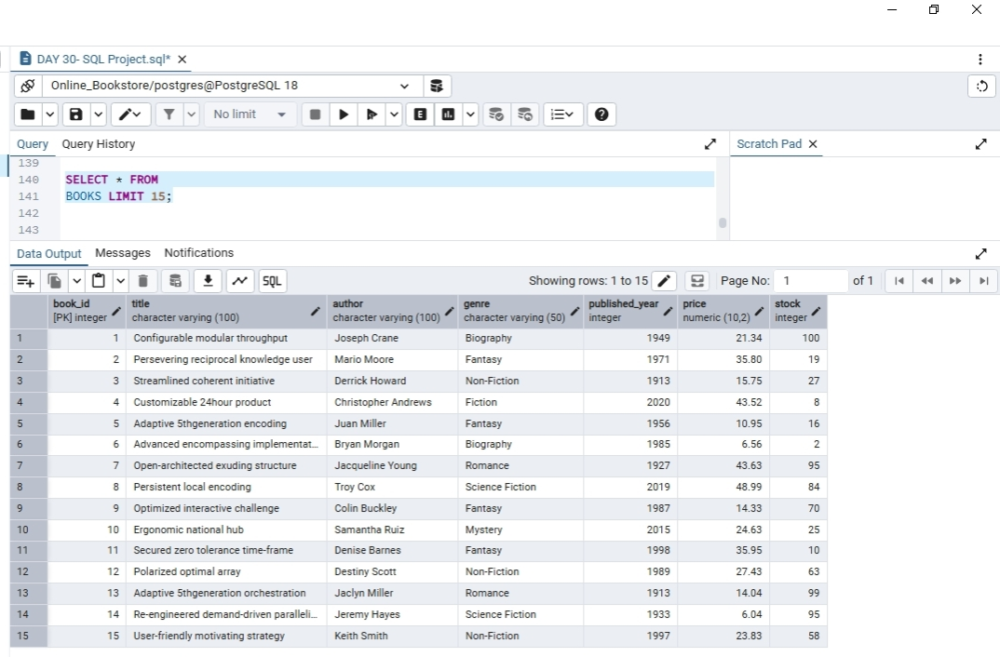
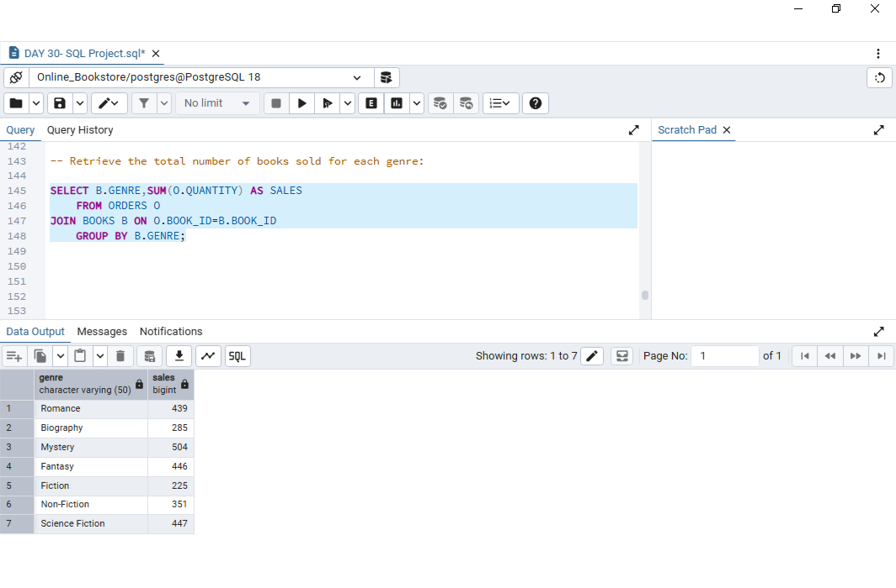
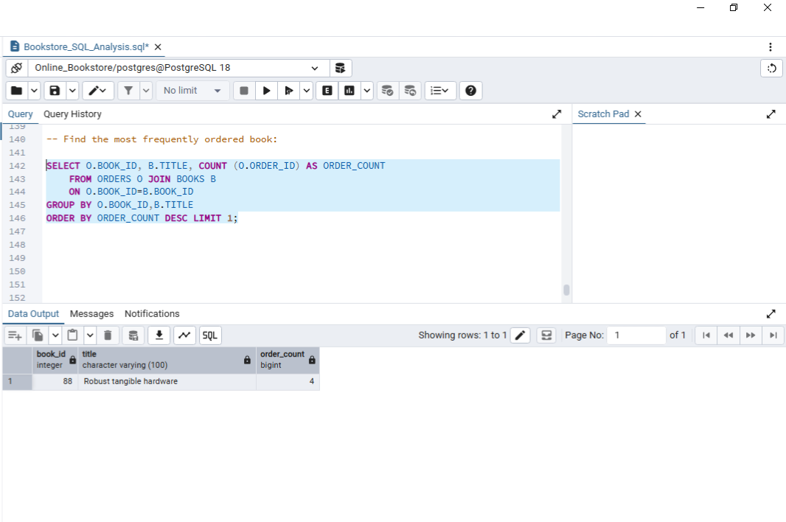
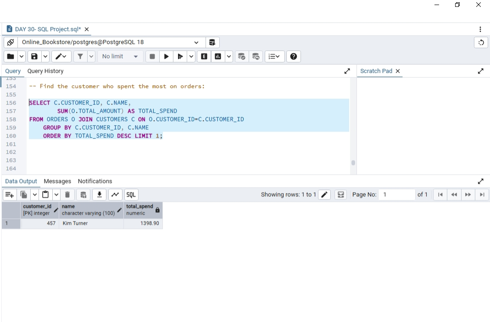

# Bookstore SQL Analysis

## Project Overview
This project focuses on analyzing bookstore data using PostgreSQL. It includes database creation, data retrieval, filtering, aggregation, and analysis using SQL queries.

## Database Structure
The project uses three related tables:

- **Books:** Book details, authors, genres, prices, and stock.
- **Customers:** Customer details and location information.
- **Orders:** Customer orders, book IDs, quantities, dates, and total amounts.

## SQL Concepts Used
- SELECT and WHERE
- ORDER BY and LIMIT
- DISTINCT
- Aggregate Functions (SUM, AVG, COUNT)
- GROUP BY and HAVING
- INNER JOIN and LEFT JOIN
- COALESCE
- Primary Keys and Foreign Keys

## Project Tasks
### Basic Analysis
- Retrieve books by genre.
- Find books by publication year.
- Filter customers by country.
- Analyze orders and book stock.
- Calculate total revenue.

### Advanced Analysis
- Genre-wise books sold.
- Average book prices.
- Customers with multiple orders.
- Most frequently ordered books.
- Author-wise sales.
- Customer spending analysis.
- Remaining stock estimation.

## Tools Used
- PostgreSQL
- pgAdmin 4

## Project File
- `Bookstore_SQL_Analysis.sql` — Database schema and SQL queries.

## Purpose
This project was created to practice SQL concepts and develop practical database analysis skills.

## Project Screenshots

### 1. Books Table

### 2. Genre-Wise Sales

### 3. Most Frequently Ordered Book

### 4. Highest Customer Spending

